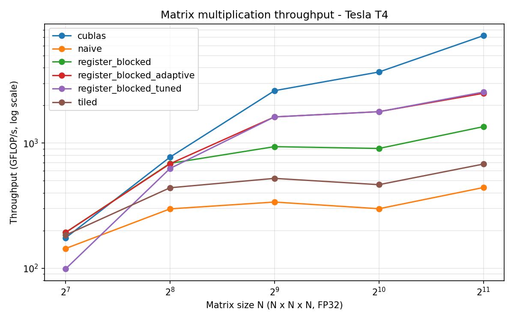

# MatrixForge

MatrixForge is a CUDA-based FP32 matrix multiplication optimization project. It implements naive, shared-memory tiled, and register-blocked kernels, compares their performance against NVIDIA cuBLAS, and evaluates an adaptive kernel-selection heuristic.

## Implemented Kernels

| Kernel | Optimization | Status |
|---|---|---|
| `naive` | One thread computes one output element | Implemented |
| `tiled` | Shared-memory tiling and data reuse | Implemented |
| `register_blocked` | Multiple outputs computed per thread using registers | Implemented |
| `register_blocked_tuned` | Configurable register-blocked kernel | Implemented |
| `register_blocked_adaptive` | Shape-based selection between original and tuned kernels | Implemented |
| cuBLAS | NVIDIA matrix multiplication library | Performance reference |

## Project Structure

- `include/` — Kernel declarations
- `src/` — CUDA kernels, benchmark, tuning, and comparison programs
- `tests/` — Test programs
- `scripts/` — Benchmark plotting script
- `results/` — CSV measurements and generated graph
- `CMakeLists.txt` — Build configuration
- `COLAB.md` — Google Colab setup instructions

## Requirements

- NVIDIA GPU with CUDA support
- CUDA Toolkit and `nvcc`
- CMake and a C++ compiler
- Python, pandas, and matplotlib for plotting

If you do not have a local NVIDIA GPU, use Google Colab with a GPU runtime.

## Build and Run

Build the project from the project directory:

```bash
cmake -B build
cmake --build build -j2
```

Run the standard correctness and performance benchmark:

```bash
./build/matmul_bench
```

Optionally benchmark selected matrix sizes:

```bash
./build/matmul_bench 256 512 1024
```

Run the repeated comparison between the original and tuned kernels:

```bash
./build/compare_kernels
```

Generate the throughput plot:

```bash
python scripts/plot_results.py
```

The standard benchmark writes `results/benchmark.csv`. The repeated comparison writes `results/kernel_comparison_repeated.csv`. The plot script writes `results/gflops.png`. Separate held-out measurements are stored in `results/benchmark_final_holdout.csv`.

## Tuned Kernel Configuration

The tuned register-blocked kernel uses this configuration:

| Parameter | Value | Purpose |
|---|---:|---|
| BM | 64 | Output tile rows |
| BN | 64 | Output tile columns |
| BK | 16 | Reduction tile depth |
| TM | 4 | Output rows accumulated per thread |
| TN | 4 | Output columns accumulated per thread |

Each CUDA thread accumulates a 4 × 4 group of output values in registers. The 64 × 64 output tile enables input-data reuse across threads, while BK = 16 processes the reduction dimension in chunks. This configuration was evaluated on a Tesla T4 and is not guaranteed to be optimal on other GPUs.

## Adaptive Kernel Selection

`register_blocked_adaptive` chooses between the original and tuned register-blocked kernels.

Current heuristic:

- Square matrices with dimension at least 384 use the tuned kernel.
- Other shapes use the original register-blocked kernel.

The threshold is a conservative, experimentally evaluated heuristic for the tested GPU, not a universal threshold or an automatic tuning system. The dispatcher has not been exhaustively validated for every rectangular shape.

## Repeated Benchmark Results

Repeated measurements were collected in one NVIDIA Tesla T4 Colab session. Each matrix size was measured over five rounds, with 20 CUDA-event timing trials per round. The table reports the median of the five round medians. Timing variation can affect the results.

| Matrix size | Original median (ms) | Tuned median (ms) | Observed speedup |
|---:|---:|---:|---:|
| 128 | 0.0143 | 0.0266 | 0.54x |
| 256 | 0.0412 | 0.0452 | 0.91x |
| 320 | 0.0676 | 0.0635 | 1.06x |
| 384 | 0.1085 | 0.0735 | 1.48x |
| 512 | 0.2274 | 0.1317 | 1.73x |
| 640 | 0.3994 | 0.1917 | 2.08x |
| 768 | 0.5970 | 0.3164 | 1.89x |
| 1024 | 1.4930 | 0.7748 | 1.93x |
| 1280 | 3.1453 | 1.6176 | 1.94x |
| 1536 | 5.4992 | 2.8844 | 1.91x |
| 2048 | 12.9275 | 7.2178 | 1.79x |

The largest observed speedup in this comparison was approximately 2.08x at 640 × 640. The tuned kernel was slower at 128 × 128 and 256 × 256, showing that one configuration is not optimal for every workload.

Detailed repeated measurements are available in `results/kernel_comparison_repeated.csv`.

## Held-Out Benchmark Results

These square matrix sizes were evaluated separately from the repeated tuning comparison. Times are from one NVIDIA Tesla T4 Colab session and are reported in milliseconds.

| Matrix size | Original (ms) | Tuned (ms) | Adaptive (ms) |
|---:|---:|---:|---:|
| 448 | 0.1939 | 0.1413 | 0.1413 |
| 896 | 1.5370 | 0.7454 | 0.7435 |
| 1792 | 8.5675 | 4.2435 | 4.2540 |

The adaptive dispatcher tracked the tuned kernel closely on these three sizes. These results are specific to the tested GPU and session.

## Comparison with cuBLAS

The following standard-benchmark measurements were collected in one NVIDIA Tesla T4 Colab session. The percentage is the tuned kernel's throughput as a fraction of cuBLAS throughput, calculated from the same benchmark run.

| Matrix size | cuBLAS (ms) | Tuned kernel (ms) | Tuned throughput (% of cuBLAS) |
|---:|---:|---:|---:|
| 1024 × 1024 | 0.5808 | 1.2062 | 48.15% |
| 2048 × 2048 | 2.3807 | 6.7180 | 35.44% |

In these measurements, cuBLAS was faster than the custom tuned kernel. The results show that MatrixForge improves on its original register-blocked implementation for many larger square sizes, while leaving room for further optimization against a highly optimized library.

## Correctness and Measurement Notes

- The standard benchmark validates kernel outputs against a reference using a maximum relative error tolerance of `1e-3`.
- Tested standard shapes include square matrices of 128, 256, 512, 1024, and 2048, plus the irregular shape 257 × 129 × 193.
- The standard benchmark checks all registered kernels, including `register_blocked_adaptive`. The latest standard run passed all 36 benchmark rows.
- Separate held-out square sizes are 448, 896, and 1792.
- GPU kernel timings use CUDA events. Repeated measurements help reveal timing variation, but results remain specific to the hardware and runtime.
- Experiments were run on an NVIDIA Tesla T4 GPU (compute capability 7.5) using CUDA Toolkit 13.0 in Google Colab.

## Benchmark Plot

The following plot is generated from the standard benchmark CSV:


